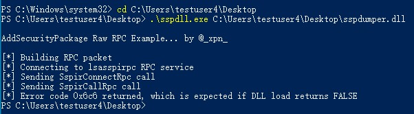

Your project is impressive, but I believe there's one important aspect that may currently be limiting its overall quality and potential.  I'd really like to discuss this with you in detail before moving forward with a pull request. I see an opportunity to introduce some meaningful improvements that could take the project to the next level and make it even more powerful.  I think there's potential here for something truly exceptional, and I'd love to share my thoughts with you.
项目中分为两个VS2019解决方案：

- sspdll https://gist.github.com/xpn/c7f6d15bf15750eae3ec349e7ec2380e
- sspdumper dll工程，用来dump内存

使用方法, SYSTEM权限下执行：

然后在C:\WINDOWS\TEMP下找到temp.bin文件，该文件就是lsass.exe进程的内存dump

注意两点：

- sspdll.exe              有时候可能需要源码免杀
- sspdumper.dll      需要填写绝对路径